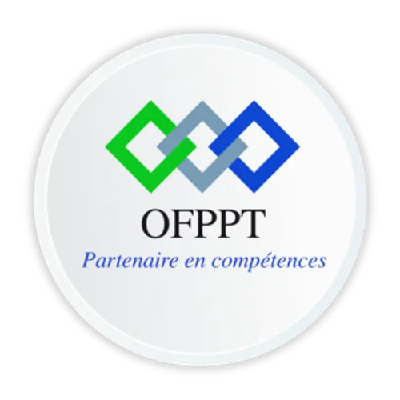

<!-- _class: title -->

# PODCAST DIRECTORY MANAGEMENT

## Technical Project Presentation

<br>

**Prepared by:** Ayoub Elfaquihi

**Supervisor:** [ES-Saraj Fouad]


**Solicode Tanger — OFPPT**




---

# INTRODUCTION

## About the project

Podcasts have become a popular way to share information, knowledge, and stories. However, finding podcasts about specific topics can sometimes be difficult.

The **Podcast Directory Management** application is a web platform that allows users to discover and organize podcasts in one place. It provides a simple way to explore podcasts by category and access useful information about them.

---

<!-- _class: title -->

# PROJECT NEEDS

## Understanding the problem and identifying the need

---

# THE PROBLEM

## Difficulties in finding and organizing podcasts

- Podcasts are available on many different platforms.
- They cover a wide range of topics.
- Users may find it difficult to search for specific podcasts.
- Discovering content that matches their interests can take time.
- Managing podcast information can become complicated when it is not properly organized.

---

# THE NEED

## A centralized podcast directory

A centralized platform is needed to organize podcast information and make it easier to access.

The application aims to provide:

- A structured directory of podcasts.
- Classification by categories.
- Easy access to podcast information.
- Simple management of the directory.

---

<!-- _class: title -->

# PROJECT ANALYSIS

## Requirements and main functionalities

---

# MAIN REQUIREMENTS

## Three main entities

- **Host:** Stores information about podcast hosts.
- **Topic:** Organizes episodes according to their subjects.
- **Episode:** Stores information about podcast episodes.

These entities are connected to organize podcast information in a structured way.

---

# MAIN FUNCTIONALITIES

## Complete CRUD operations

The administrator can perform four main operations:

1. **Create:** Add new hosts, topics, and episodes.
2. **Read:** Display and view existing information.
3. **Update:** Modify existing records.
4. **Delete:** Remove records from the directory.

---

# DATA ORGANIZATION

## Main entities and their operations

| Entity | Main Information | Operations |
|---|---|---|
| Host | Host information | Full CRUD |
| Topic | Name and description | Full CRUD |
| Episode | Title, description, date, duration | Full CRUD |

---

# APPLICATION REQUIREMENTS

## What the application needs to provide

- Organize podcast information in a structured database.
- Connect episodes with their hosts and topics.
- Provide an interface for managing all records.
- Keep information organized and easy to access.

---

<!-- _class: title -->

# PROJECT DESIGN

## Database structure and relationships

---

# DATABASE STRUCTURE

## Three main database tables

| Table | Description |
|---|---|
| Animateur (Host) | Stores podcast host information. |
| Thematique (Topic) | Stores podcast categories and topics. |
| Episode | Stores episode details and connects each episode to a host and a topic. |

---

# DATABASE RELATIONSHIPS

## One-to-Many relationships

- One host can be associated with many episodes.
- One topic can contain many episodes.
- Each episode belongs to one host and one topic.

---

# SIMPLIFIED DATA MODEL

## Database entities and foreign keys

```text
ANIMATEUR
- id_animateur (PK)
- nom
- prenom
       |
       | 1
       |
       | N
EPISODE
- id_episode (PK)
- titre
- description
- date_publication
- duree_episode
- id_animateur (FK)
- id_thematique (FK)
       |
       | N
       |
       | 1
THEMATIQUE
- id_thematique (PK)
- nom
- description
```

---

<!-- _class: title -->

# PROJECT IMPLEMENTATION

## Technologies and prototype

---

# TECHNICAL STACK

## Technologies used in the application

| Technology | Purpose |
|---|---|
| HTML | Structure of web pages |
| Tailwind CSS | Interface styling |
| JavaScript | Additional user interactions |
| Alpine.js | Reactive frontend interactions |
| PHP | Backend programming language |
| Laravel | Backend framework |
| MySQL | Database management |
| Eloquent ORM | Database operations and relationships |

---

# APPLICATION FUNCTIONALITIES

## Full CRUD management

The application provides complete CRUD operations for its main entities:

- **Create:** Add new records.
- **Read:** Display and view existing records.
- **Update:** Modify existing information.
- **Delete:** Remove records.

These operations are available for hosts, topics, and episodes.

---

# APPLICATION WORKFLOW

## How the application works

1. The administrator accesses the application.
2. The administrator manages hosts, topics, and episodes.
3. Laravel handles application requests and business logic.
4. Eloquent ORM communicates with the MySQL database.
5. Alpine.js manages interactive elements on the interface.
6. The application displays the updated information.

---

# EXAMPLE OF EPISODE DATA

## JSON representation

```json
{
  "title": "Introduction to Web Development",
  "description": "An episode about the basics of web development.",
  "publication_date": "2026-11-02",
  "duration": 30,
  "host": "Example Host",
  "topic": "Technology"
}
```

---

# PROJECT PROTOTYPE

## Application interface

The prototype demonstrates a complete management system with interfaces for creating, displaying, editing, and deleting records.

exmple :


---

# PROJECT PROGRESS

## Main development activities

- [ ] Design the application interface.
- [ ] Create the database and its relationships.
- [ ] Develop CRUD operations for hosts.
- [ ] Develop CRUD operations for topics.
- [ ] Develop CRUD operations for episodes.
- [ ] Test the application.

---


<!-- _class: title -->

# CONCLUSION

## Project results and final objective

---

# PROJECT CONCLUSION

The **Podcast Directory Management** project aims to provide a centralized platform for organizing and managing podcast information.

Through complete CRUD operations, administrators can manage hosts, topics, and episodes efficiently.

Using Laravel, Alpine.js, and MySQL, the application provides a structured and interactive solution for podcast directory management.

**The final goal is to make podcast information easier to organize, manage, and discover.**

> A well-organized directory makes podcast information easier to manage and discover.

---

<!-- _class: title -->

# THANK YOU

## Thank you for your attention!

**Podcast Directory Management**

**Ayoub Elfaquihi**
