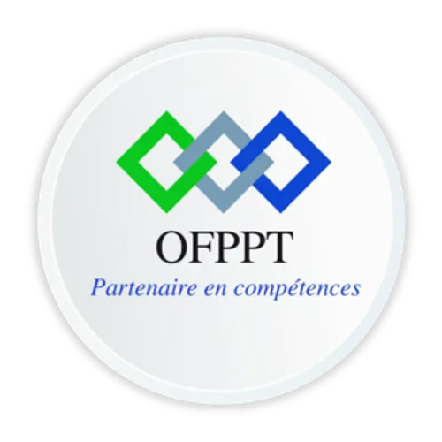
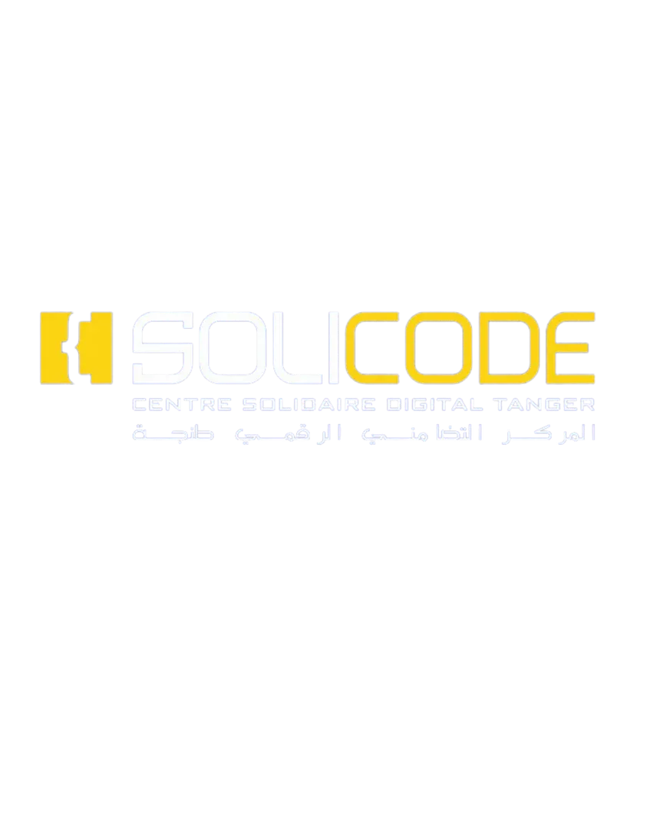

<!-- _class: title -->
<!-- _paginate: false -->

  
  

# Labs & Stack Technique

## Technical Project

**Podcast Directory Management**

 

**Prepared by:** Ayoub Elfaquihi

**Supervisor:** [ES-Saraj Fouad]

**Training Center:** Solicode Tanger

**Institution:** OFPPT

---

<!-- _class: intro -->

# Projet Technique

## Introduction

A technical project is an opportunity to apply the knowledge and skills acquired during training to develop a real-world application.

Throughout this project, we explore different technologies, tools, and development methods to build a complete web application.

## Podcast Directory Management

The project focuses on developing a web application that provides a structured and centralized directory for podcast content.

It allows administrators to manage podcast hosts, topics, and episodes through an interactive interface, ensuring organized data and efficient management.

---

<!-- _class: stack -->

# Technical Stack

The project uses different technologies, each with a specific role in the development process.

## Markup & Styling

- **HTML** — Structures web pages.
- **CSS** — Controls visual presentation.
- **Tailwind CSS** — Utility-first CSS framework.

## Programming Languages

- **JavaScript** — Handles frontend interactions.
- **PHP** — Handles backend logic.

## Frameworks & Libraries

- **Laravel** — PHP backend framework.
- **Alpine.js** — Adds reactive frontend interactions.

## Database & ORM

- **MySQL** — Stores and manages application data.
- **Eloquent ORM** — Handles database operations and relationships in Laravel.

---

# Understanding Labs

## What is a Lab?

A Lab is a practical learning activity focused on exploring and experimenting with a specific technology, tool, or development concept.

## Why Do We Do Labs?

- Discover and understand new technologies.
- Test tools and solutions through practice.
- Develop technical skills.
- Solve specific development challenges.

## What Is the Link with the Technical Project?

Labs help us prepare for the technical project by allowing us to experiment with technologies, test solutions, and develop individual parts of the application before integrating them into the final project.

> A Lab connects learning with practical project development.

---

<!-- _class: labs -->

# List of Labs

## Phase 1 — Tools & Technologies (1–10)

<ol>
<li>Qu'est-ce qu'un lab ? — Understanding Labs</li>
<li>Markdown — Syntax and documentation</li>
<li>GitHub Pages — Static hosting</li>
<li>Antigravity — Python project management</li>
<li>Marp — Markdown presentations</li>
<li>OpenCode — Development environment</li>
<li>Pandoc — Document conversion</li>
<li>OmniRoute — Advanced routing</li>
<li>Tailwind CSS — Utility-first CSS</li>
<li>Preline — UI components with Tailwind</li>
</ol>

## Phase 2 — Methodologies & Collaboration (11–16)

<ol start="11">
<li>2TUP — Development methodology</li>
<li>Design Thinking — User-centered approach</li>
<li>GitHub Issues — Ticket management</li>
<li>Scrum — Agile methodology</li>
<li>GitHub Copilot — AI-assisted development</li>
<li>ASCII — Text-based art and diagrams</li>
</ol>

## Phase 3 — Development & Languages (17–24)

<ol start="17">
<li>OOP — Object-oriented programming</li>
<li>PHP Native — PHP without a framework</li>
<li>Laravel — PHP framework</li>
<li>Kotlin — Modern programming language</li>
<li>ES7 JavaScript — Modern JavaScript features</li>
<li>Error JS — JavaScript error handling</li>
<li>Prompt-Agent-Skill — AI and automation</li>
<li>Communication avec IA — AI interaction</li>
</ol>

## Phase 4 — Project & Production (25–30)

<ol start="25">
<li>Veille technologique — Technology monitoring</li>
<li>Starter — Starter templates</li>
<li>Planning — Project planning</li>
<li>Git — Advanced version control</li>
<li>Lab Stack — Complete technical stack</li>
<li>Agent — AI agent automation</li>
</ol>

---

<!-- _class: thanks -->
<!-- _paginate: false -->

# Thank You!

## Questions?

**Labs & Stack Technique**

Ayoub Elfaquihi — Solicode Tanger
